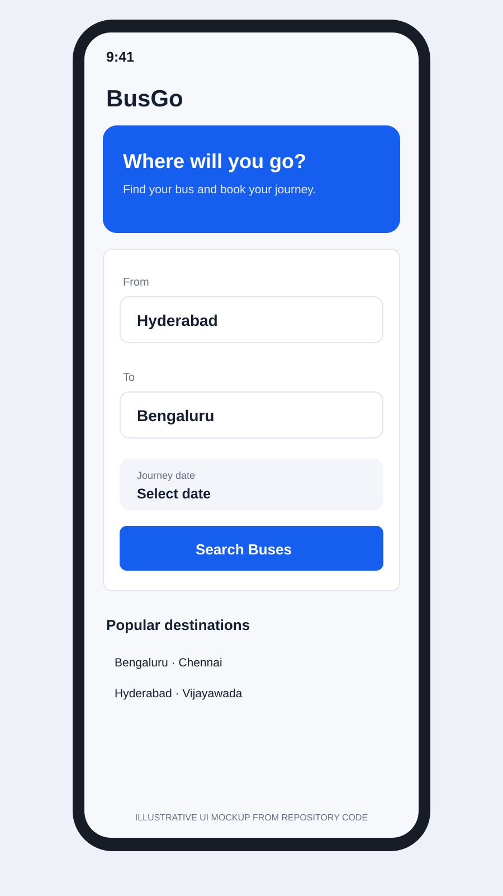
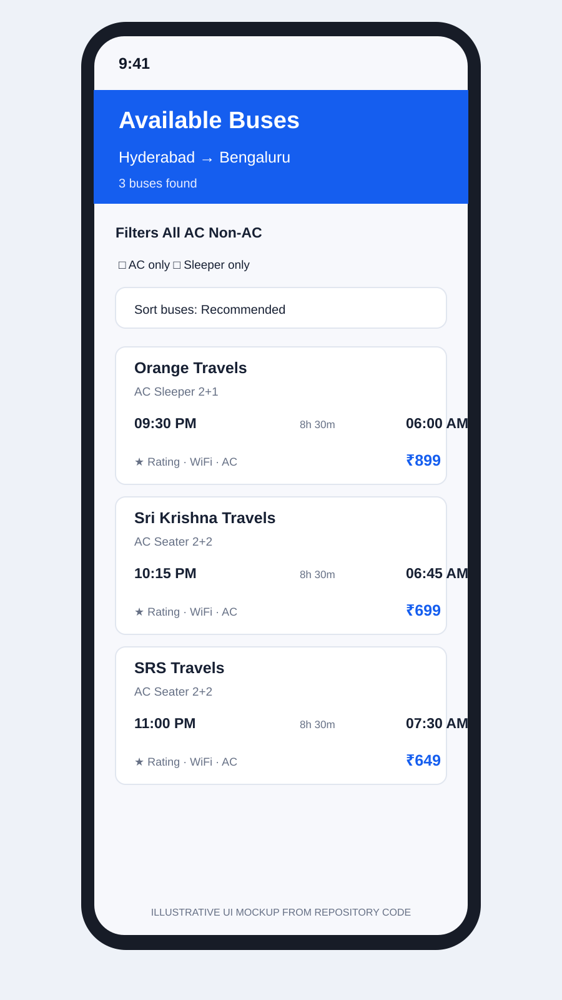
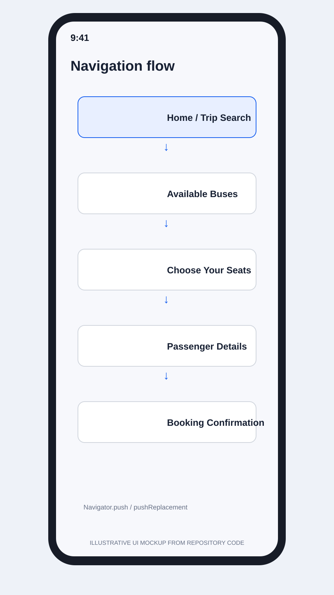
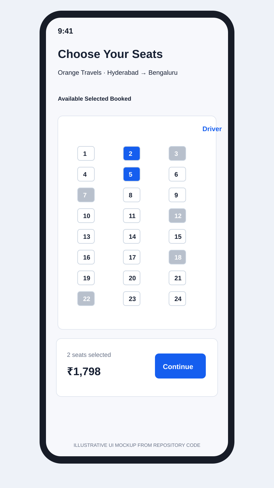
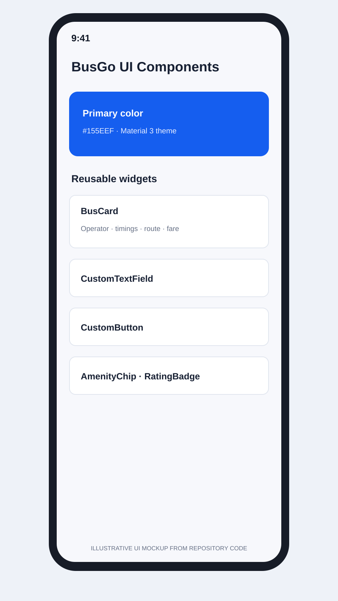
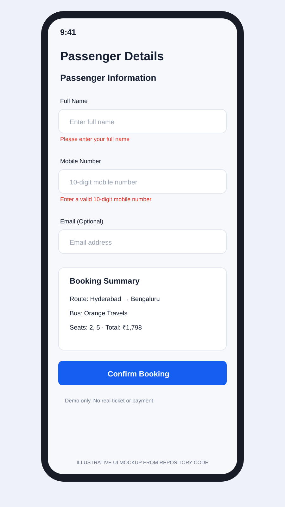

# BusGo — Flutter Bus Booking System

BusGo is a Flutter/Dart bus-booking demo application. This README is based on the source code currently present in this repository. It documents implemented code only; it does not claim that unimplemented lab-manual exercises are complete.

## Project details

- **Application:** BusGo
- **Framework:** Flutter
- **Language:** Dart
- **Entry point:** `lib/main.dart`
- **Start screen:** `SplashScreen`, followed by `HomeScreen`
- **Package name:** `project` (from `pubspec.yaml`)

## Implemented application workflow

1. **Trip search** — enter source and destination, swap locations, select a journey date, and validate the search.
2. **Available buses** — view sample bus results, filter by bus type/AC/sleeper, and sort results.
3. **Bus details** — view bus type, departure/arrival, amenities, and operator policy.
4. **Seat selection** — select available seats and calculate the selected-seat fare.
5. **Passenger details** — enter passenger name, mobile number and optional email; form validation is applied.
6. **Payment demo** — choose UPI or card and continue through a simulated delay. This is not a real payment gateway.
7. **Booking confirmation** — display a demo booking reference and ticket summary. The QR area is a placeholder, not a scannable ticket.

> **Important limitations visible in the code:** bus data is sample/local data; payment is simulated; the confirmation screen explicitly labels the ticket and QR as demo content; the My Bookings screen says booking history is not connected. Do not treat this project as a live booking or payment service.

## Lab manual experiment mapping

The sections below follow the experiment titles in **UI Design – Flutter Lab Manual 2026**. An experiment is marked as supported only where matching code exists in this repository.

### Experiment 1 — Installation of Flutter & Dart SDK and Introduction to Dart Programming

**Repository evidence:** `pubspec.yaml` declares a Flutter project and Dart SDK constraint. SDK installation and the `flutter doctor` environment setup are machine-level activities, not application screens stored in this repository.

**Screenshot:** Capture your own terminal showing `flutter --version` and `flutter doctor` after running them in your development environment. No such environment screenshot is currently stored in this repository.

### Experiment 2 — Exploring Flutter Widgets and Implementing Different Layout Structures using Row, Column, and Stack Widgets

**Repository evidence:** Flutter widgets and layouts are used throughout the existing BusGo UI:
- `lib/screens/home_screen.dart` — Scaffold, AppBar, ListView, Column, Row, Container, Card, TextField, buttons and date selection.
- `lib/screens/search_results_screen.dart` — Column, Row, filter controls and bus result layout.
- `lib/widgets/bus_card.dart` — reusable Card, Row and Column layout.

**Code-based UI previews:**



*Figure 2.1: Home screen and trip search form, based on `lib/screens/home_screen.dart`.*



*Figure 2.2: Available bus cards, filters and sorting, based on `lib/screens/search_results_screen.dart` and `lib/widgets/bus_card.dart`.*

### Experiment 3 — Design a Responsive User Interface Using MediaQuery and LayoutBuilder

**Repository review:** No use of `MediaQuery` or `LayoutBuilder` was identified in the reviewed application source. The app uses scrollable layouts in places, but that alone does not demonstrate the specific MediaQuery/LayoutBuilder experiment.

**Status:** Not demonstrated by the current code. No screenshot is claimed for this experiment.

### Experiment 4 — Navigation Between Different Screens Using Navigator and Named Routes

**Repository evidence:** The app uses direct Navigator navigation:
- `lib/screens/splash_screen.dart` — `Navigator.pushReplacement` to the home screen.
- `lib/screens/home_screen.dart` — `Navigator.push` to search results.
- `lib/screens/search_results_screen.dart` — navigation to seat selection.
- The booking flow passes bus, route, date and seat data through screen constructors.

**Note:** `lib/core/constants/app_routes.dart` defines route-name constants, but `lib/main.dart` does not register a `routes` map or use `initialRoute`; named-route navigation is therefore not demonstrated by the app entry point.

**Code-based navigation flow preview:**



*Figure 4.1: Screen sequence represented by the app's Navigator calls. This is a flow illustration, not a runtime capture.*

### Experiment 5 — Understanding Stateful and Stateless Widgets and Implementing State Management using setState() and Provider

**Repository evidence:** The app uses both StatelessWidget and StatefulWidget. Local state updates with `setState()` are present in screens such as:
- `lib/screens/home_screen.dart` — journey-date selection.
- `lib/screens/search_results_screen.dart` — filters and sorting.
- `lib/screens/seat_selection_screen.dart` — selected seats.
- `lib/screens/payment_screen.dart` — selected payment method and loading state.

**Status:** Stateful/Stateless widgets and local `setState()` are demonstrated. Provider/ChangeNotifier is not declared in `pubspec.yaml` and is not demonstrated by the current project.

**Code-based UI preview:**



*Figure 5.1: Seat grid, booked/selected seat states and calculated fare, based on `lib/screens/seat_selection_screen.dart`. Illustrative preview, not a device capture.*

### Experiment 6 — Creating Custom Widgets and Applying Themes and Custom Styles in Flutter

**Repository evidence:**
- `lib/core/theme/app_theme.dart` — central `ThemeData`, color scheme, AppBar, Card and button themes.
- `lib/core/theme/app_colors.dart` and `lib/core/theme/app_text_styles.dart` — shared styling definitions.
- `lib/widgets/custom_button.dart` — reusable custom button.
- `lib/widgets/custom_text_field.dart` — reusable text field.
- Other reusable widgets include `BusCard`, `AmenityChip`, `RatingBadge`, `CouponCard` and `EmptyState`.

**Code-based UI preview:**



*Figure 6.1: Theme colors and reusable widget examples, based on `lib/core/theme/app_theme.dart` and `lib/widgets/`.*

### Experiment 7 — Designing Forms with Various Input Fields and Implementing Form Validation and Error Handling

**Repository evidence:**
- `lib/screens/passenger_details_screen.dart` — Form, GlobalKey<FormState>, TextFormField and validation for passenger details.
- `lib/utils/validators.dart` — name, phone, email and age validation helpers.
- `lib/widgets/custom_text_field.dart` — reusable TextFormField with validator support.

**Code-based UI preview:**



*Figure 7.1: Passenger form and representative validation messages, based on `lib/screens/passenger_details_screen.dart`. The displayed errors illustrate validator output; they are not a captured test run.*

### Experiment 8 — Implementing UI Animations Using Flutter Animation Framework and Experimenting with Fade and Slide Animations

**Repository review:** `lib/screens/splash_screen.dart` uses a delayed navigation transition, but no `AnimatedOpacity`, `AnimatedContainer`, `AnimatedPositioned`, AnimationController or Tween implementation was identified in the reviewed code.

**Status:** The specific fade/slide animation experiment is not demonstrated by the current code. No animation screenshot is claimed.

### Experiment 9 — Fetching Data from a REST API and Displaying the Data in Flutter UI

**Repository review:** Bus results are sourced from `lib/data/sample_buses.dart`. `lib/services/bus_service.dart` filters this local sample data. `pubspec.yaml` does not declare the HTTP package, and no REST GET/JSON API integration was identified.

**Status:** REST API fetching and JSON display are not implemented in the current project. No API screenshot is claimed.

### Experiment 10 — Writing Unit Tests for Flutter UI Components and Using Flutter Debugging Tools to Identify and Fix Issues

**Repository evidence:**
- `test/bus_service_test.dart` — checks that BusService returns results for a matching route.
- `test/formatters_test.dart` — checks currency and date formatter output.
- `test/widget_test.dart` — currently contains the generated counter-app smoke test.

**Review finding:** The current widget test imports `main.dart` and calls `MyApp`, but the application class in `lib/main.dart` is `BusBookingApp`. The generated test also expects a counter and plus button that are not part of the BusGo app. This test does not currently test the BusGo UI and is expected to fail until it is rewritten for the actual app.

**Screenshot:** No test-result screenshot is included because a real `flutter test` run has not been captured. Run `flutter test` locally and add the actual terminal output here after verification.

## Project structure

```
lib/
├── core/
│   ├── constants/
│   └── theme/
├── data/
├── models/
├── screens/
├── services/
├── utils/
└── widgets/
test/
```

## Run the application

```bash
git clone https://github.com/srivardhan29906-hub/bus-booking-app.git
cd bus-booking-app
flutter pub get
flutter run
```

## Run tests

```bash
flutter test
```

Test execution has not been performed as part of this README review. Use the command above to verify the current state locally.

## Screenshot policy

Only genuine screenshots captured from this BusGo project should be placed in the experiment sections above. The `screenshots/` folder contains clearly labelled **code-based UI previews** generated from the current Flutter widget structure. They help readers understand the intended layout, but they are not genuine emulator/device captures and must not be treated as runtime or test evidence. Experiments 1, 3, 8, 9 and 10 do not have screenshots because the required environment evidence or implemented feature/test output is not available in the repository.
